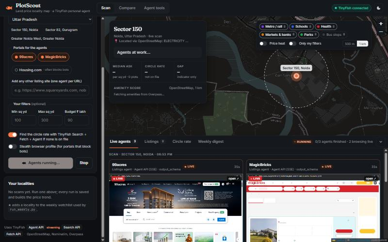
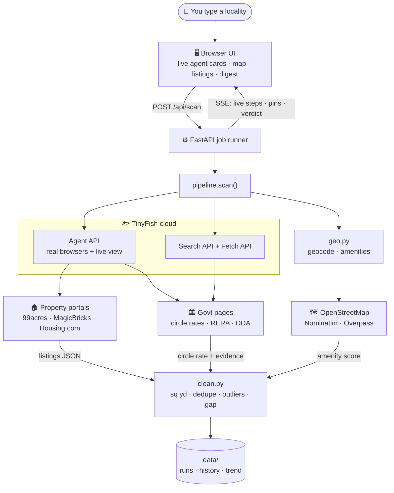
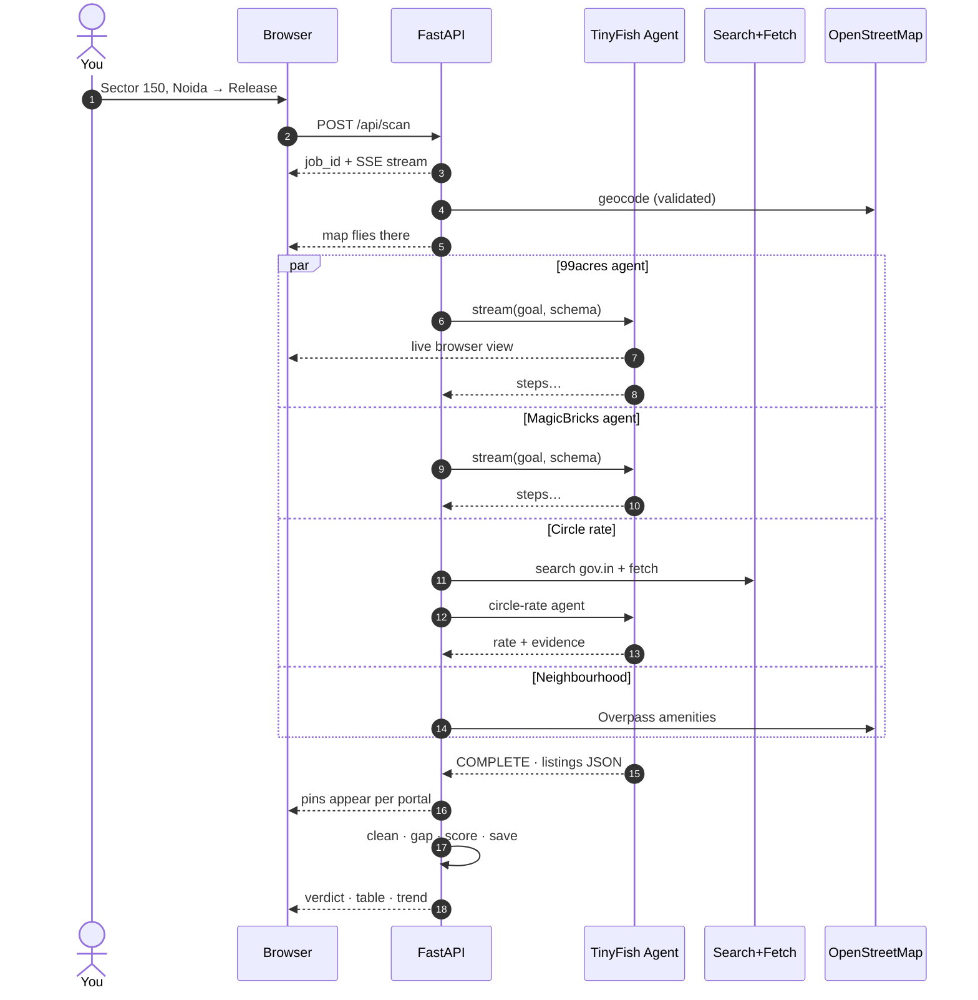
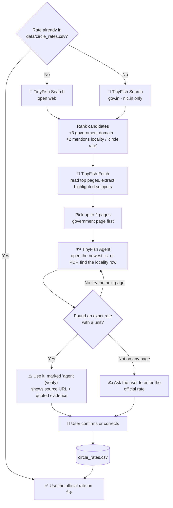
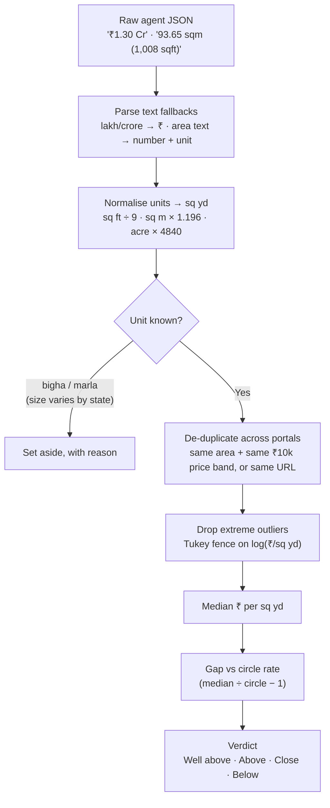
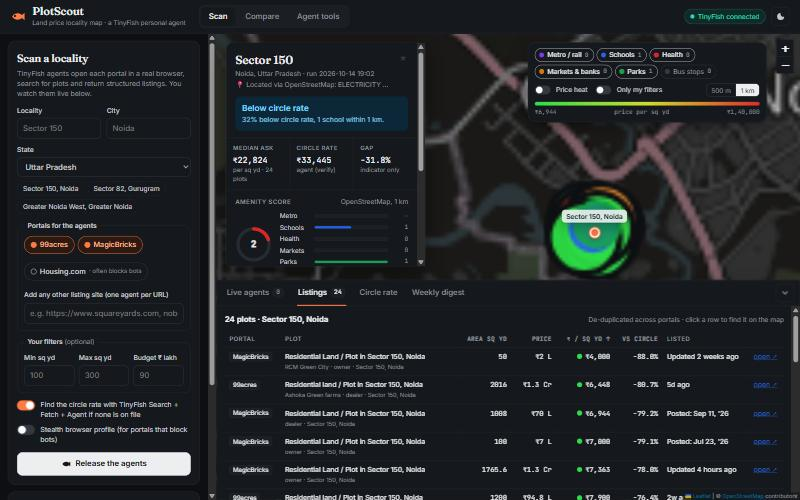
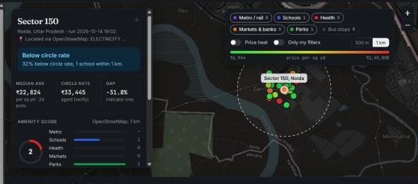

<div align="center">

# 🐟 PlotScout

### Your weekly land-price errand, done by an AI agent.

**Give it a locality. It tells you whether plots there are priced above or below the government circle rate,<br/>and shows you what's around them on a map.**


*Built for the **TinyFish × DTU** workshop: "build your own personal agent that does real tasks on the live web."*



<sub>☝️ Not a mock-up. Two TinyFish agents are browsing 99acres and MagicBricks in real time, streamed into the app.</sub>

</div>

---

## 😩 The problem

If you've ever helped your family buy a plot in India, you know the drill:

- You open **99acres**, then **MagicBricks**, then **Housing.com**. The same plot shows up three times at three prices.
- Someone asks *"but what's the circle rate?"* That number lives in a government PDF on a district website nobody can find.
- A price per square yard means nothing until you know whether there's a **metro, school or hospital** nearby.
- Prices move, so you do it all again **next week**. Listing sites only show today's price. There's no history.

It's slow, repetitive, and exactly the kind of work an agent should do.

## ✨ What PlotScout does

You type a locality, say **"Sector 150, Noida"**, and press **Release the agents**.

| | |
|---|---|
| 🕵️ **Agents browse for you** | TinyFish agents open each property portal in a real browser, search for plots and return clean, structured listings. You **watch them work live**. |
| 🏛️ **Finds the circle rate** | A Search → Fetch → Agent pipeline looks for the government rate, prefers `.gov.in` sources and quotes the exact line it read. |
| 🧹 **Cleans the mess** | Converts sq ft, sq m, acre and gaj to sq yd, parses "₹1.3 Cr" and "70 Lac", merges duplicates across portals and drops junk. |
| 🗺️ **Maps the neighbourhood** | Colour-coded price pins, a 500 m / 1 km ring, schools, hospitals, metro, parks and markets from OpenStreetMap, plus an amenity score. |
| ⚖️ **Gives a verdict** | *"32% below circle rate, 1 school within 1 km."* One honest sentence. |
| 📈 **Remembers** | Every run is saved, so a weekly price trend and a digest of new listings and price drops build up over time. |

And because it's an agent platform, not a scraper, the same engine also does:

- ✅ **RERA check**: searches the state RERA portal for a project (one click from any listing).
- 🏗️ **Government land auctions**: lists current plot schemes on DDA, Noida Authority, GNIDA, YEIDA and HSVP sites.
- 💬 **Ask an agent anything**: any website, any plain-English goal.

---

## 🧠 How TinyFish powers it

This project uses **three TinyFish products** and real browser agents, not canned data.

| Feature | TinyFish API | Why it matters |
|---|---|---|
| Listings from each portal | **Agent API, streaming** (`client.agent.stream`) + `output_schema` | The agent decides the clicks and typing from one plain-English goal. We stream `STARTED → STREAMING_URL → PROGRESS → COMPLETE` to the UI. |
| Live browser view | `STREAMING_URL` event | Embedded as an iframe in each agent card, so you can watch the agent work. |
| Circle-rate discovery | **Search API** (open + `include_domains=gov.in,nic.in`) | Finds candidate pages, government sites first. |
| Reading candidate pages | **Fetch API** with query highlights | Pulls the most relevant snippets before spending an agent run. |
| Extracting the rate | **Agent API** + schema | Returns the rate, unit, category, date and **evidence** (the exact row it read). |
| Portals that block bots | `browser_profile="stealth"` | One toggle in the UI. |
| Stop button | `POST /v1/runs/{id}/cancel` | Stops the remote browsers, so no credits are wasted. |

---

## 🏗️ Architecture



## ⚡ What happens when you press "Release the agents"



## 🏛️ The circle-rate pipeline

Circle rates are the hardest number to find, so they get their own three-step pipeline. It never invents a number.



## 🧹 From messy listings to a verdict



| Gap vs circle rate | Verdict |
|---|---|
| more than +25% | **Well above circle rate** |
| +10% to +25% | **Above circle rate** |
| −10% to +10% | **Close to circle rate** |
| below −10% | **Below circle rate** |

**Amenity score (out of 10, based on OpenStreetMap data):** metro/rail within 500 m = 3 (1 km = 2, 2 km = 1) · schools within 1 km up to 2 · health 2 · markets and banks 1.5 · park 1 · 2+ bus stops 0.5.
Metro gets the biggest weight because hedonic studies of Delhi and Gurugram found transit distance to be a key driver of plot prices.

---

## 📊 A real run (14 Oct 2026)

<div align="center">

</div>

**Sector 150, Noida.** 99acres + MagicBricks, run live:

| | |
|---|---|
| Listings collected | **24** (12 + 12), each linked back to its source |
| Median asking price | **₹22,824 / sq yd** |
| Circle rate found by agent | **₹40,000 / sq m ≈ ₹33,445 / sq yd** (from a portal article, so marked *verify*) |
| Verdict | **32% below circle rate**, 1 school within 1 km |
| Agent time | MagicBricks ≈ 4.7 min · 99acres ≈ 8.5 min (it waited for a free browser) |

<div align="center">

</div>

> Sector 150 turned out to have **two markets in one sector**: farmhouse land at about ₹7k/sq yd and villa plots at about ₹1.4 lakh/sq yd. That's exactly why the map and the table matter more than any single number.

---

## 🧪 What we learned building on the live web

Real portals are messy. These are the things we hit and fixed:

1. **Account concurrency is real.** Our key runs about **2 browsers at once**. A third agent shows `STARTED` with no browser until a slot frees. The UI shows this as *"starting / waiting for a browser"* instead of looking frozen.
2. **Strict schemas can backfire.** With `area` and `price` as required numbers, 99acres came back with **0 listings** even though the agent said it had extracted 12. Making the schema loose, adding `price_text` and `area_text`, and parsing those ourselves fixed it.
3. **`output_schema` has rules.** It rejects `description` fields and type arrays like `["string","null"]`. Use `nullable: true`.
4. **Anti-bot pages happen.** Housing.com showed *"Request Blocked"* in both lite and stealth mode, so it's off by default and the agent reports `blocked: true` honestly instead of returning nothing.
5. **TinyFish re-routes on its own.** When MagicBricks denied access, the agent reconfigured itself and a **new streaming URL** arrived mid-run. The UI swaps the live view automatically.
6. **Geocoders guess.** Nominatim matched "Sector 150, Noida" to **Sector 18**, 18 km away. Every hit is now checked to make sure it contains the sector number, with Photon as a fallback and a loud warning if we fall back to the city centre.
7. **Textbook outlier rules fail on real markets.** A "0.4×–2.5× median" filter threw away 19 of 24 listings in a two-cluster market. A log-scale Tukey fence keeps the real data and drops only junk.
8. **Public Overpass is moody.** It sometimes times out, so amenities are retried after the agents finish.

---

## 🚀 Quick start

```bash
git clone https://github.com/shivanshgoyal100/tinyfish.git
cd tinyfish
python -m venv .venv
.venv\Scripts\activate            # macOS/Linux: source .venv/bin/activate
pip install -r requirements.txt
```

Create a `.env` file (get a key at [agent.tinyfish.ai/api-keys](https://agent.tinyfish.ai/api-keys)):

```env
TINYFISH_API_KEY=sk-tinyfish-...
```

Check your key works (about 30 s, prints live agent events):

```bash
python smoke_test.py
```

Run the app:

```bash
python server.py                  # http://localhost:8000  (set PORT=8010 if 8000 is busy)
```

Then pick a preset such as **Sector 150, Noida** and press **Release the agents**. A scan takes about **5–10 minutes**, depending on how many browsers your account can run at once.

### Weekly autopilot

Star ★ a locality in the UI, then schedule the CLI runner:

```bash
python run_weekly.py              # scans the ★ watchlist, prints the digest
```

```bash
# Windows Task Scheduler: every Monday at 08:00
schtasks /Create /SC WEEKLY /D MON /ST 08:00 /TN PlotScoutWeekly /TR "<path>\.venv\Scripts\python.exe <path>\run_weekly.py"

# macOS / Linux cron
0 8 * * 1 cd /path/to/tinyfish && .venv/bin/python run_weekly.py
```

---

## 🗂️ Project structure

```
├── server.py            FastAPI: starts jobs, streams events to the browser (SSE, reload-safe)
├── run_weekly.py        CLI: weekly scan of the ★ watchlist + digest
├── smoke_test.py        30-second check that your TinyFish key works
├── app/
│   ├── agents.py        TinyFish layer: goals, schemas, streaming runner, circle-rate pipeline
│   ├── pipeline.py      One scan: agents in parallel → clean → gap → amenities → save
│   ├── clean.py         Units, price/area parsing, dedupe, outliers, verdict
│   ├── geo.py           Validated geocoding, Overpass amenities, amenity score
│   ├── store.py         Runs, history.csv, weekly digest, watchlist
│   └── config.py        Portals, state RERA / authority URLs, presets
├── web/                 index.html · app.js · style.css (Leaflet, no build step)
├── data/
│   ├── circle_rates.csv Official rates you enter or confirm (0 = unknown)
│   ├── history.csv      Weekly medians → trend line
│   └── runs/            Every scan, saved as JSON (doubles as an offline demo fallback)
└── docs/screenshots/
```

---

## 🛡️ Responsible by design

- **Indicator, not proof.** Listing prices are *asking* prices. The circle rate must match the same unit and land category. The UI always shows the source and date of the rate.
- **No invented numbers.** The circle-rate agent is told never to guess or average. Agent-found rates are marked **verify** until a human confirms them.
- **Approximate pins, said out loud.** Listings only name a locality, so pins are jittered and labelled approximate.
- **Polite agents.** Goals forbid clicking contact, enquiry or login buttons and never type personal details. Nominatim is rate-limited to 1 request per second and cached.
- **Not legal advice.** The RERA check is a first pass. Always confirm on the official portal.
- **Read each portal's terms** before automating it, and keep runs small.

## 🛣️ Roadmap

- [ ] **Serverless mode** (Vercel): queue runs with `/run-async` and poll `/v1/runs/{id}`, which already returns `steps` and `streaming_url`, so no request has to stay open for minutes.
- [ ] Official circle-rate parsers for more states (UP IGRS, Haryana jamabandi, Delhi DoR).
- [ ] Browser Context Profiles for portals that need a login.
- [ ] Email or WhatsApp weekly digest.
- [ ] MapLibre 3D view and per-listing geocoding from project names.

## 🙏 Built with

[TinyFish](https://docs.tinyfish.ai) (Agent, Search and Fetch APIs) · [FastAPI](https://fastapi.tiangolo.com) · [Leaflet](https://leafletjs.com) + [leaflet.heat](https://github.com/Leaflet/Leaflet.heat) · [OpenStreetMap](https://www.openstreetmap.org/copyright) data via Nominatim, Photon and Overpass.

Map data © OpenStreetMap contributors. Research behind the design: Singhal & Tyagi (2021) on Delhi Metro and property values; *Influence of MRTS on plotted residential prices, Gurugram* (IJCUA); Kashyap & Berry (2015) on the Jaipur Metro.

<div align="center">

**Made at the TinyFish × DTU workshop** 🐟

*If this saved you a weekend of tab-switching, give it a ⭐*

</div>
